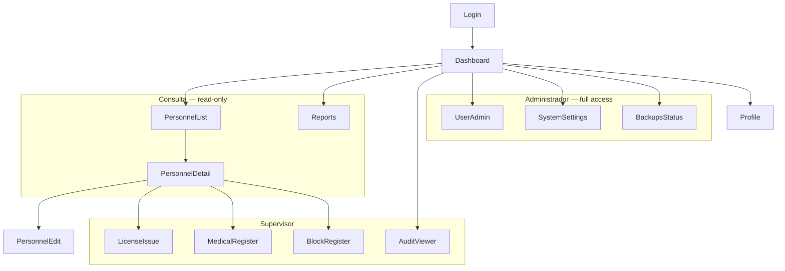

# SRYG — Design Brief Runbook

This is the working brief for SRYG's design system and every screen it needs to cover. It exists so a designer, or a design-system generator, can start producing components and views without re-deriving product context from the thesis. Read `sryg-definitions-and-tasks.md` first for entities, roles, and business rules — this document assumes that context and focuses on views, interaction, and visual direction.

## 1. Purpose and how to use this with a design-system generator

Use this document as the input brief to a design-system generator (tokens → components → templates). Feed it section by section:

1. §2–§3 for brand direction and users → generates tone and density decisions.
2. §5 for information architecture → generates navigation structure.
3. §6 (one view per entry) → generates page templates and their states.
4. §7–§8 for shared patterns and component inventory → generates the token set and component library.
5. §9–§10 for accessibility and responsive rules → generates constraints the generator must enforce.
6. §11 is a ready-to-paste summary prompt if you only have room for one input.

Everything marked **inferred** or **proposed** is a design decision this brief is making in the absence of source specification — treat it as a starting direction, not a locked brand decision. Everything else traces to `openspec/changes/sryg-product-definition/exploration.md`.

## 2. Product and brand context

SRYG is a government aviation-safety tool: institutional, trustworthy, and used daily by a small technical staff to handle dense regulatory data (licenses, ratings, medical certificates, audit trails). It is not a consumer product — the design should read as precise and credible before it reads as friendly.

**Logo analysis** (`docs/4cb0a814-0c95-4639-94c0-bfe204db3bb8.jpg`, viewed): a white ring pierced by a star/compass-needle mark, rendered on black. The mark reads as a navigation/precision motif appropriate to aviation. It is inherently monochrome and high-contrast, which makes a **dark-first** UI a natural extension of the mark rather than a stylistic add-on.

**Proposed direction — not a final palette**:
- Monochrome base: near-black background, near-white foreground, both in dark and light mode.
- Reserve exactly **one accent color for status semantics** (credential state, alerts) and nowhere else — a status badge should be the only reliably colored element on a screen, so color keeps its meaning. Do not derive decorative accents from the same hue family used for status, to avoid diluting it.
- Do not treat this palette as final. It is a proposed starting point for the design-system generator; INAC branding guidelines, if any exist outside the thesis, should override it.

## 3. Users and personas

The thesis surveys a real population of 9 staff (source 2657–2715):

| Group | Count | Primary need |
|---|---|---|
| Taquilla Técnica de Licencias staff | 4 | Register personnel, issue/renew licenses and certificates — desk-based, high daily volume |
| Gerencia de Seguridad Aeronáutica supervisors | 2 | Oversight, approvals, reports — office-based |
| Ramp Safety Inspectors (Inspectores de Seguridad Aeronáutica en Rampa) | 3 | Consult records during ramp checks — **may use tablets or phones on the ramp**, so responsive design matters for this group specifically |

**Mapping to system roles — inferred, not stated in the source**:

| Persona | System role | Confidence |
|---|---|---|
| Taquilla Técnica staff | Administrador | Inferred — they perform the create/update actions (registro, emisión) the source assigns to administrative staff |
| Gerencia de Seguridad Aeronáutica supervisors | Supervisor | Inferred — title match with "Supervisor de Licencias," a UML illustrative actor (source 1324–1337) |
| Ramp Safety Inspectors | Consulta | Inferred — title match with "Inspector de Seguridad Aeronáutica en Rampa," a UML illustrative actor (source 1324–1337); field consultation implies read-only |

This mapping should be confirmed with INAC before it drives access decisions in production — it is a design assumption, not a requirement from the source.

## 4. UI copy language — open decision

The thesis is written in Spanish and all domain terms are Spanish (Licencia, Habilitación, etc.). **Recommendation: ship the product UI in Spanish (es-VE)** — the user base is Venezuelan government staff working with Spanish-language regulations (RAV 60/RAV 67) and Spanish source documents; an English UI would force constant mental translation for no benefit. This is a recommendation, not a resolved decision — confirm with INAC before locking copy. (This runbook and the definitions document are in English per this project's technical-artifact-language rule; that rule does not extend to end-user product copy.)

## 5. Information architecture and navigation per role

Consulta's navigation surfaces only list/detail/reports; Supervisor and Administrador add the issue/register/resolve actions and admin surfaces per the proposed permission matrix in `sryg-definitions-and-tasks.md` §4.

## 6. Views

Each entry: purpose, roles with access, data shown, options/actions, filters/search, states, key components, source traceability.

### Login

- **Purpose**: authenticate and route to the role-appropriate dashboard.
- **Roles**: all — unauthenticated entry point.
- **Data shown**: none until authenticated.
- **Options/actions**: email/username + password fields, submit, "forgot password" link.
- **Filters/search**: none.
- **States**: empty (initial), loading (submitting), error (invalid credentials, locked account), success (redirect).
- **Key components**: AuthTemplate, FormField, Button, AlertBanner (error).
- **Source traceability**: inferred (login is a prerequisite for JWT auth, source 1739–1749); not an explicit screen in the thesis.

### Dashboard / Alerts

- **Purpose**: single landing surface showing open expiry alerts and system status at a glance.
- **Roles**: all — content differs. Administrador/Supervisor see counts across all personnel; Consulta sees only what their read access permits.
- **Data shown**: near-expiry and expired credential counts, recent blocks, recent audit activity (Administrador/Supervisor only).
- **Options/actions**: click through to filtered personnel list or reports.
- **Filters/search**: filter alerts by credential type, by near-expiry vs. expired.
- **States**: empty (no open alerts), loading, error (data fetch failed), success, warning (blocked credentials present).
- **Key components**: DashboardTemplate, AlertBanner, DashboardAlertList, StatusBadge.
- **Source traceability**: inferred from "alertas de vencimiento" (1167–1168) and real-time consolidated status for the directive (435–439); explicit dashboard screen is inferred, not named directly.

### Personnel list/search (consulta)

- **Purpose**: find a person's record quickly.
- **Roles**: all — Consulta's primary screen; Administrador/Supervisor use it as an entry point to registro/emisión.
- **Data shown**: name, cédula, category, current credential status summary per row.
- **Options/actions**: open detail; Administrador/Supervisor also see "new personnel" action.
- **Filters/search**: by name, cédula, category, credential status.
- **States**: empty (no results), loading, error, success, — (no explicit warning state at list level).
- **Key components**: ListPageTemplate, SearchBar, DataTable, StatusBadge, Pagination.
- **Source traceability**: explicit — query/lookup screen (source 1189–1191).

### Personnel detail / expediente

- **Purpose**: the electronic personnel file — single place to see everything about one person.
- **Roles**: all — read for Consulta; Administrador/Supervisor also reach edit/issue/register actions from here.
- **Data shown**: tabs — datos (personal/contact data, photo), licencias, habilitaciones, certificados médicos, bloqueos, historial.
- **Options/actions**: edit (registro), issue/renew license or certificate, register a block, view audit history for this person.
- **Filters/search**: within historial tab, filter by date range or entity type.
- **States**: loading, error, success, blocked/warning (banner when an active block exists — persistent across all tabs, not just the bloqueos tab).
- **Key components**: DetailPageTemplate, ExpedienteTabs, StatusBadge, AlertBanner, AuditLogTable (historial tab).
- **Source traceability**: "expediente electrónico" (source 2046–2048); tab structure is inferred from the entity relationships in `sryg-definitions-and-tasks.md` §5.

### Personnel create/edit (registro)

- **Purpose**: create or update a `PersonalAeronautico` record.
- **Roles**: Administrador, Supervisor (per proposed matrix). Consulta has no access.
- **Data shown**: form pre-filled with existing data on edit.
- **Options/actions**: save, cancel, upload/replace photo.
- **Filters/search**: none.
- **States**: empty (create), loading, error (validation failure), success (saved).
- **Key components**: FormPageTemplate, FormField, PhotoUpload, Button.
- **Source traceability**: explicit — registration screen (source 1189–1191); personnel registry scope (584–591).

### License & rating issue/renew (emisión)

- **Purpose**: issue or renew a `Licencia`/`Habilitacion`, running the automatic block check before confirming.
- **Roles**: Administrador, Supervisor.
- **Data shown**: license category, dates, current status, block-check result.
- **Options/actions**: submit issue/renew; if the block check fails, the submit action is disabled and the impediment is shown instead.
- **Filters/search**: none (acts on one person, reached from their detail view).
- **States**: loading, error, success, **blocked** (the block-check result is a first-class state, not an error — it names the specific impediment).
- **Key components**: IssueRenewForm, StatusBadge, AlertBanner (blocked state).
- **Source traceability**: explicit — issuance screen (1189–1191); automatic block check (615–625); state machine (1288–1291, 1417–1426, 2635–2638).

### Medical certificate register/renew

- **Purpose**: register or renew a `CertificadoMedico` — administrative fields only.
- **Roles**: Administrador (write, per proposed matrix); Supervisor/Consulta read-only or no access.
- **Data shown**: RAV 67 class, issue date, expiry date, general operational restrictions.
- **Options/actions**: submit register/renew.
- **Filters/search**: none.
- **States**: loading, error, success, blocked (same block-check pattern as licenses).
- **Key components**: FormPageTemplate, FormField, AlertBanner ("no clinical data" notice, persistent, not dismissible), StatusBadge.
- **Source traceability**: medical certificate scope (603–613) — **explicit guidance**: this form must never include a diagnosis, history, or free-text clinical field; only type, dates, and general restrictions (606–610).

### Block/impediment register and resolution

- **Purpose**: register a detected impediment, and later resolve it once formally solved.
- **Roles**: register — Administrador, Supervisor; resolve — role gated by OD-08 in `sryg-definitions-and-tasks.md` (proposed: Administrador, Supervisor).
- **Data shown**: reason, registration date, status (open/resolved), resolved-by.
- **Options/actions**: register block; resolve block (requires confirmation, see §7 destructive-action pattern for the "prevents issuance" consequence).
- **Filters/search**: by status (open/resolved).
- **States**: empty, loading, error, success, blocked (this view's own subject).
- **Key components**: BlockResolutionPanel, StatusBadge, ConfirmDialog.
- **Source traceability**: automatic blocking mechanism (615–625); "Alerta de bloqueo" glossary entry (2006–2009).

### Reports (catalog pending)

- **Purpose**: generate statistical/compliance reports for the directive.
- **Roles**: Administrador, Supervisor (export); Consulta (limited read, per proposed matrix).
- **Data shown**: depends on report type — v1 covers personnel with near-expiry/expired credentials and a real-time consolidated status report (see `sryg-definitions-and-tasks.md` REP-01). Full catalog is OD-10, still open.
- **Options/actions**: run report, export (format pending OD-10).
- **Filters/search**: date range, credential type, personnel category.
- **States**: empty (no matching records), loading, error, success.
- **Key components**: ListPageTemplate, DataTable, filter controls.
- **Source traceability**: directive reports (627–630, 435–439); near-expiry/expired listing (740–742). Catalog detail explicitly not specified in the source.

### Audit trail viewer

- **Purpose**: inspect the immutable log of operations for compliance and traceability.
- **Roles**: Administrador, Supervisor. Consulta has no access (proposed).
- **Data shown**: actor, action, entity, timestamp per row.
- **Options/actions**: export.
- **Filters/search**: by actor, date range, entity type, action.
- **States**: empty, loading, error, success.
- **Key components**: AuditLogTable, SearchBar, Pagination.
- **Source traceability**: explicit requirement for immutable indexed audit trail (627–633, 1360–1361, 2022–2025, 2108–2111, 1768–1774).

### User & role administration

- **Purpose**: manage `Usuario` accounts and role assignment.
- **Roles**: Administrador only.
- **Data shown**: user list with role, status (active/deactivated), last login.
- **Options/actions**: create user, edit role, deactivate/reactivate, reset password.
- **Filters/search**: by role, by status.
- **States**: empty, loading, error, success.
- **Key components**: ListPageTemplate, DataTable, ConfirmDialog (deactivate is destructive-pattern).
- **Source traceability**: `Usuario` base class with role subclasses (1401–1407); security/access-control scope (635–639).

### System settings/parameters

- **Purpose**: configure the values the source leaves as open parameters — validity periods, alert threshold, notification channel — instead of hardcoding them.
- **Roles**: Administrador only.
- **Data shown**: current parameter values, grouped by category (license validity, medical validity, alert threshold, notification channel).
- **Options/actions**: edit and save each parameter.
- **Filters/search**: none.
- **States**: loading, error, success (with confirmation that a value changed).
- **Key components**: FormPageTemplate, FormField.
- **Source traceability**: this screen exists because BR-02/BR-12 and OD-05/OD-06/OD-09 in `sryg-definitions-and-tasks.md` require these values to be configurable, not because the thesis names a settings screen.

### Backups status (if in UI)

- **Purpose**: show that automated backups are running, for operational confidence.
- **Roles**: Administrador only.
- **Data shown**: last backup timestamp, status (success/failure), size.
- **Options/actions**: trigger manual backup (optional), view restore instructions link.
- **Filters/search**: none.
- **States**: loading, error (backup failed), success.
- **Key components**: DashboardTemplate (small panel), StatusBadge.
- **Source traceability**: automated backup/restore scripts required (640–641, 2597–2600); whether this surfaces in the UI at all is a design choice, not a source requirement — may ship as an ops runbook instead (see `sryg-backups-ops` OPS-04).

### Profile / change password

- **Purpose**: let a user view their own account info and change their password.
- **Roles**: all.
- **Data shown**: own email, role (read-only), last login.
- **Options/actions**: change password.
- **Filters/search**: none.
- **States**: loading, error, success.
- **Key components**: FormPageTemplate, FormField.
- **Source traceability**: inferred — standard account management, not explicit in the source.

### Error / 403 / 404 pages

- **Purpose**: fail clearly when access is denied or a resource doesn't exist.
- **Roles**: all.
- **Data shown**: error code, plain-language explanation, link back to dashboard.
- **Options/actions**: return to dashboard/login.
- **Filters/search**: none.
- **States**: this view is itself an error state.
- **Key components**: AuthTemplate or a minimal ErrorTemplate.
- **Source traceability**: inferred — required by RBAC enforcement (NFR-04) even though not named as a screen.

## 7. Cross-cutting patterns

**Status badges** — Activa, Próxima a vencer, Vencida, Bloqueada/Suspendida (name pending OD-07):

| State | Meaning | Non-color cue |
|---|---|---|
| Activa | Credential currently valid | Check-mark icon |
| Próxima a vencer | Nearing expiry (threshold pending OD-05) | Warning/clock icon |
| Vencida | Expired | X or "expired" icon |
| Bloqueada / Suspendida | Blocked — issuance prevented until resolved | Lock/pause icon |

Every badge pairs its color with an icon and a text label — never color alone (WCAG 2.2 SC 1.4.1).

**Alerts/banners**: inline page banner for an active block on a personnel detail page (persistent, not dismissible while the block is open); dashboard summary cards for alert counts; toast notifications for save/error confirmations.

**Data tables**: sortable columns, pagination, sticky header, row click opens detail. Default to a denser row height for Taquilla Técnica staff's high daily volume; a comfortable-density toggle is a reasonable addition, not a source requirement.

**Forms and validation**: inline field-level errors, required-field markers, date pickers constrained to plausible ranges, the block-check result computed and shown before the user can submit an issue/renew action.

**Destructive-action confirmations**: a modal naming the specific consequence in plain language (e.g., "Deactivating this user revokes their access immediately" — not a generic "are you sure?"). Type-to-confirm for the highest-consequence actions (deactivate user, resolve a block). Every destructive action writes an audit entry (BR-11).

**Audit indicators**: "last modified by X at Y" shown on detail views, linking to the full trail for that entity.

**Photo handling**: upload with preview, fallback silhouette avatar when absent. Storage mechanism is OD-03 (open) — the UI component should be storage-agnostic (accepts a URL/reference, not implementation-specific).

**Print/export**: a dedicated print/export action on the personnel detail view for the credential output (format pending OD-09); a separate export action on reports and the audit viewer (format pending OD-10).

## 8. Component inventory by atomic level

| Level | Components |
|---|---|
| Atoms | Button, Input, Select, DatePicker, Badge/StatusChip, Icon, Avatar/PhotoThumbnail, Checkbox, Radio, Tooltip, Label |
| Molecules | FormField (label + input + error), SearchBar, AlertBanner, TableRow, Pagination, Tabs, Breadcrumb, ConfirmDialogTrigger |
| Organisms | DataTable, ExpedienteTabs, IssueRenewForm, BlockResolutionPanel, DashboardAlertList, AuditLogTable, NavSidebar/AppShellNav |
| Templates | ListPageTemplate, DetailPageTemplate, FormPageTemplate, DashboardTemplate, AuthTemplate, ErrorTemplate |
| Pages | The 15 views in §6, each an instance of one of the templates above |

## 9. Accessibility

- Target **WCAG 2.2 AA**.
- Full keyboard operability: logical tab order, visible focus state, skip-to-content link on every template.
- Contrast: body text ≥ 4.5:1, large text/icons ≥ 3:1, checked against both the dark-first and light variants.
- Status is never color-only — every StatusBadge and AlertBanner pairs color with an icon and a text label (see §7).
- Form labels are programmatically associated with inputs; validation errors are announced via `aria-live`.
- Touch targets ≥ 44×44px — required for the tablet/phone use case of ramp inspectors, not just a general guideline here.

## 10. Responsive breakpoints

**Proposed, inferred** — the thesis does not specify breakpoints, but does establish that ramp inspectors consult the system on tablets and phones on the ramp (source 2689–2711), which makes responsive support a real requirement, not a nice-to-have.

| Breakpoint | Range | Priority use case |
|---|---|---|
| Mobile | ≤ 480px | Ramp inspector, phone, Consulta lookups |
| Tablet | 481–1024px | Ramp inspector, tablet — treat as a first-class target, not a shrink of desktop |
| Desktop | ≥ 1025px | Taquilla Técnica desk, Supervisor office |

Tables and forms should have an explicit tablet layout (not just a squeeze of the desktop grid), since that is where the field-use persona actually works.

## 11. Design-system generation brief

Copy-pasteable summary for a design-system generator:

> Design a dark-first, monochrome-base UI for SRYG, a government aviation-safety credential-management tool (INAC Maracay, Venezuela). Brand mark: a white ring pierced by a star/compass-needle shape on black — precise, institutional, navigation-themed. Base palette: near-black/near-white monochrome in both dark and light mode; reserve exactly one accent color for status semantics only (credential state and alerts), never for decoration. Every status indicator must pair color with an icon and a text label — color alone is never sufficient (WCAG 2.2 AA). Primary users: front-desk licensing staff (desktop, high daily data-entry volume, dense tables), safety supervisors (desktop, oversight/reports), and ramp inspectors (tablet and phone, field lookups — responsive design is a real requirement, not optional). Content is dense and regulatory: licenses, ratings, medical certificates (administrative data only, explicitly never clinical), audit trails, block/impediment states. Build on atomic design (atoms → molecules → organisms → templates → pages) and a container-presentational component split. Cover at minimum: login, dashboard/alerts, personnel list/search, personnel detail with tabs (data, licenses, ratings, medical certificates, blocks, history), personnel create/edit, license/rating issue-renew with a first-class "blocked" state, medical-certificate register/renew with a persistent no-clinical-data notice, block register/resolve, reports, audit-trail viewer, user/role administration, system settings, backups status, profile, and error/403/404 pages. Target WCAG 2.2 AA throughout.
