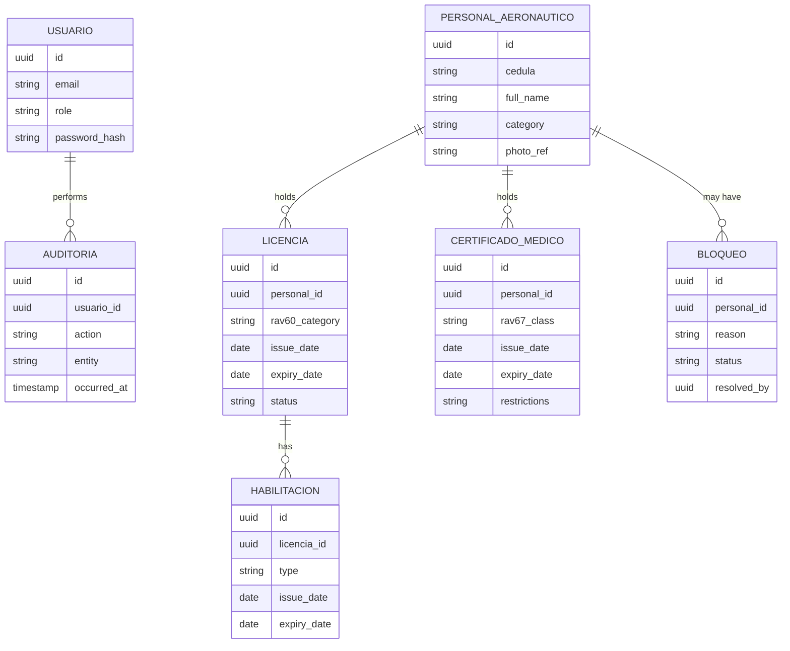
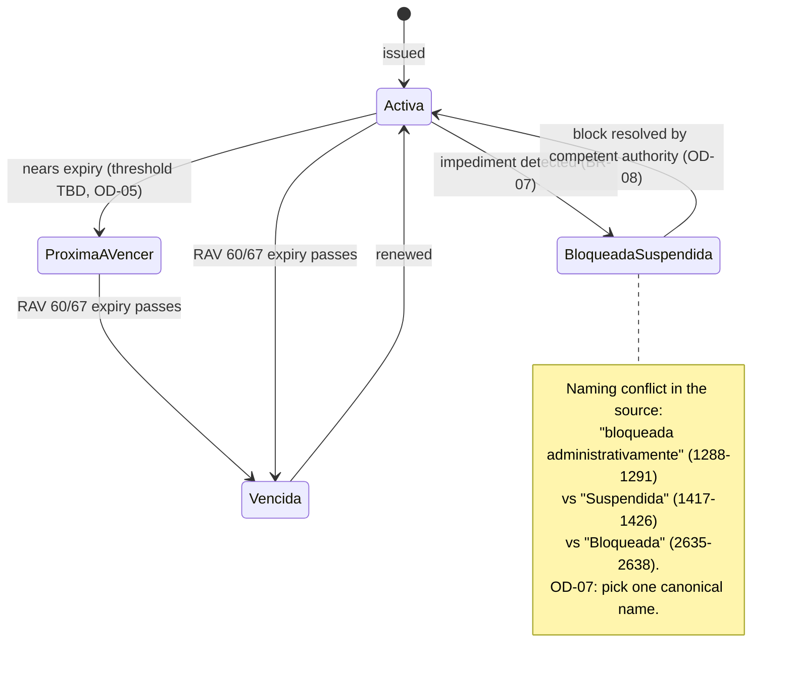
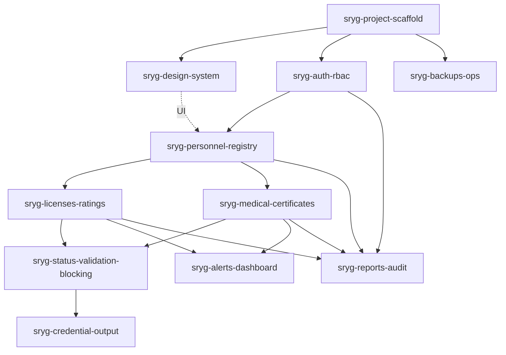

# SRYG — Product Definitions & Task Roadmap

SRYG is the automated credential-management system for aeronautical personnel at INAC Maracay (Venezuela). This document is the master reference: what the system must do, the terms it uses, its domain model, its business rules, and the task checklist for every planned change. Read this before writing specs, design docs, or code for any SRYG change.

## 1. Purpose and how to use this document

- **If you're writing a spec or design for an SRYG change**: start at §4 (roles), §5 (domain model), §6 (business rules) and §8 (NFRs). Every requirement you write must cite a BR-xx or NFR-xx ID from here, or add a new one.
- **If you're picking up implementation work**: go to §12 (task checklists) and find your change's section (e.g. `AUTH-*` for `sryg-auth-rbac`).
- **If you're deciding something the thesis didn't specify**: check §10 (decisions log) first — it may already be tracked as an open decision.
- **Source of truth**: `docs/thesis.docx` (engineering thesis), extracted with line citations in `openspec/changes/sryg-product-definition/exploration.md`. Every fact below cites its source line range; anything without a citation is an explicit inference, marked as such.
- **Numbers rule**: this document never invents a regulation number (validity period, threshold, etc.). Where the thesis doesn't give one, it says so and treats the number as a configurable parameter to be supplied later by INAC or the RAV texts.

## 2. Product overview

**Problem.** INAC Maracay tracks licenses, ratings, and medical certificates for aeronautical personnel using physical files and local spreadsheets. This causes slow lookups, typos, and duplicate records; weak oversight during ramp inspections; and the risk that personnel with expired documents or undetected medical impediments perform safety-critical functions (exploration.md, source lines 303–315, 383–392, 397–400, 427–429).

**Objective.** Build a web system that centralizes personnel, license/rating, and medical-certificate records; validates status automatically at issue and renewal; and blocks issuance when an impediment is registered (source 479–502, 615–625).

**In scope** (source 577–658):
- Personnel registry
- License and rating control (RAV 60)
- Medical-certificate administration (RAV 67, administrative data only)
- Status validation and automatic blocking at issue/renewal
- Reports and audit trail
- Security and role-based access control

**Out of scope** (source 649–658):
- Clinical medical evaluation — only administrative results are recorded, never diagnoses or histories
- Other INAC areas: finance, materiel, HR hiring, training not tied to license issuance/renewal

**Delimitation.** Maracay regional office only, for the initial delivery (source 375–382). Multi-office scope is an open decision — see OD-13.

## 3. Glossary

Domain terms stay in Spanish (they're how INAC staff and the source regulations name them); this table gives the English meaning for readers who don't work in aviation licensing.

| Term (Spanish) | English meaning |
|---|---|
| Licencia | License — RAV 60 credential authorizing a person to exercise a function (pilot, ATC, technician, cabin crew) |
| Habilitación | Rating — a specific authorization attached to a license, e.g. for a particular aircraft type or function |
| Certificado Médico | Medical certificate — RAV 67 credential, classes 1/2/3; administrative fields only, no clinical data |
| Taquilla Técnica (de Licencias) | Technical Licensing Desk — the front-office function that registers and issues licenses |
| Personal Aeronáutico | Aeronautical personnel — the tracked individual (pilot, cabin crew, maintenance technician, air traffic controller) |
| Expediente (electrónico) | Personnel file / dossier — the electronic record aggregating a person's data, licenses, ratings, certificates, and history |
| Vigente / Activa | Active / current credential status |
| Próxima a vencer | Near-expiry status |
| Vencida | Expired status |
| Bloqueada / Suspendida | Blocked / suspended status — the source uses both names inconsistently; see OD-07 |
| Alerta de bloqueo | Block alert — fired when an impediment is detected |
| Autoridad competente | Competent authority — the role empowered to lift a block; not named in the source, see OD-08 |
| Gerencia de Seguridad Aeronáutica | Aviation Safety Management — the office whose supervisors oversee safety |
| Inspector de Seguridad Aeronáutica en Rampa | Ramp Aviation Safety Inspector — field role that consults records during ramp checks |
| Cédula | National ID number |
| RAV 60 | Reglamento Aeronáutico Venezolano 60 — Venezuelan regulation governing personnel licensing |
| RAV 67 | Reglamento Aeronáutico Venezolano 67 — Venezuelan regulation governing medical certification |
| Directiva | Directive / executive leadership — consumer of statistical and compliance reports |

## 4. Roles and permission matrix

The source names three system roles and says access is "restringido según el perfil" (restricted per profile), but **never defines a permission-per-module matrix** (source 636–639, 727–730, 914–916, 1169–1170, 2067–2070). The matrix below is a proposal built from the scope and rules the thesis does give; it is not sourced from the thesis and **must be validated with INAC** before AUTH-07 is considered done.

**Roles**: Administrador, Supervisor, Consulta (abstract `Usuario` base class with these three subclasses — source 1401–1407).

> **PROPOSED — pending INAC validation.** Legend: C=Create, R=Read, U=Update, D=Delete/Resolve, — = no access.

| Module | Administrador | Supervisor | Consulta |
|---|---|---|---|
| Personnel registry | CRUD | CRUD | R |
| Licenses & ratings | CRUD | CRUD | R |
| Medical certificates | CRUD | R | R |
| Status validation / blocking | CRUD | CRUD (register + resolve) | R |
| Alerts & dashboard | R | R | R |
| Reports | R + export | R + export | R (limited) |
| Audit trail viewer | R | R | — |
| User & role administration | CRUD | — | — |
| System settings / parameters | CRUD | — | — |
| Backups status | R | — | — |
| Credential output (print/export) | C | C | — |

Rationale for the ambiguous rows:
- **Medical certificates**: source says CRUD is restricted to "authorized administrative staff" (611–613) without naming a role; proposal assigns write access to Administrador only and read to the other two, since no clinical data is stored so read exposure is low-risk.
- **Status validation / blocking**: the "competent authority" that resolves a block is unnamed (source 615–625); proposal includes Supervisor because the role title "Supervisor de Licencias" appears among the illustrative UML actors (1324–1337). This is the same gap as OD-08.

## 5. Domain model

**Entities** (source 1183–1186, plus attributes from 584–633, 792–810, 1360–1361):

| Entity | Key attributes | Notes |
|---|---|---|
| `PersonalAeronautico` | cédula, full name, contact data, photo, blood type, cargo(s), dependencia(s), institutional status, personnel category | 1→N with `Licencia` and `CertificadoMedico` (source 1388–1392) |
| `Licencia` | RAV 60 category, issue date, expiry date, status | Participates in the credential state machine (§7) |
| `Habilitacion` | type, issue date, expiry date | Attached to a `Licencia`, independently dated (source 1029–1034, 2050–2053) |
| `CertificadoMedico` | RAV 67 class (1/2/3), issue date, expiry date, operational restrictions | Administrative fields only — no diagnoses or clinical histories (source 606–613) |
| `Usuario` | email, role, password hash | Base of `Administrador` / `Supervisor` / `Consulta` |
| `Auditoria` | actor, action, entity, timestamp | Written on every operation/modification (source 627–633, 1360–1361, 2022–2025, 2108–2111) |
| `Bloqueo` (inferred) | reason, status, resolved-by | Not named explicitly in the source; inferred from the block/impediment mechanism at 615–625. Backs BR-07/BR-08 and the `sryg-status-validation-blocking` change. |

Constraint: no credential may exist without a titular — referential integrity is required (source 1660–1664). A named backend component, `GeneradorCredencialPDF`, depends on `ValidadorVigenciaRAV60` (source 1372–1379) — relevant to `sryg-credential-output`.



## 6. Business rules

Every rule cites its regulatory basis and source lines. Where the thesis gives no number, the rule says so explicitly — treat the number as an INAC-supplied, configurable parameter, never a hardcoded constant.

| ID | Rule | Basis | Source |
|---|---|---|---|
| BR-01 | A `Licencia` must belong to one of the RAV 60 personnel categories (airline transport pilot, commercial pilot, private pilot, cabin crew, maintenance technician, ATC). | RAV 60 | 792–800, 794–797 |
| BR-02 | License, rating, and medical-certificate validity periods are not fixed in this system's requirements; they must be configurable parameters, sourced from RAV 60/RAV 67 text or supplied by INAC. | RAV 60 / RAV 67 | "No numeric validity periods in the source" (exploration §4, §10.9) |
| BR-03 | A `CertificadoMedico` must be one of three RAV 67 classes: Class 1 (airline/commercial pilot), Class 2 (private pilot), Class 3 (ATC). | RAV 67 | 803–806, 604–605 |
| BR-04 | Medical-certificate validity varies by age and function; no numeric values are given in the source (see BR-02). | RAV 67 | 802–810 |
| BR-05 | `CertificadoMedico` stores only type, issue date, expiry date, and general operational restrictions. Diagnoses and clinical/medical histories are explicitly excluded. | RAV 67 / scope | 606–610 |
| BR-06 | `CertificadoMedico` records may be created, read, updated, or deleted only by authorized administrative staff. | RAV 67 / scope | 611–613 |
| BR-07 | On any credential registration or renewal, the system must check for a registered administrative, medical, or regulatory impediment; if found, it fires a block alert and prevents issuance until the impediment is formally resolved and registered by the competent authority. | RAV 60 / RAV 67 | 615–625 |
| BR-08 | The role authorized to resolve ("formalmente solventar") a block is not named in the source. Open — see OD-08. | RAV 60 / RAV 67 | 615–625 |
| BR-09 | The system must validate coherence between a license, its ratings, and the holder's medical certificate. | RAV 60 / RAV 67 | 738–740 |
| BR-10 | No credential (`Licencia`, `Habilitacion`, `CertificadoMedico`) may exist without a titular `PersonalAeronautico`; referential integrity is required. | Data integrity | 1660–1664 |
| BR-11 | Every create/update/delete operation on a tracked entity must write an `Auditoria` record with actor and timestamp. | ISO/IEC 27001-aligned audit | 627–633, 1360–1361, 2022–2025, 2108–2111 |
| BR-12 | The system must detect near-expiry and expired credentials and raise expiry alerts. No numeric threshold is given in the source — see OD-05. | RAV 60 / RAV 67 | 599–601, 1167–1168 |
| BR-13 | Access to each module is restricted according to the user's role profile. | Security scope | 639–640 |
| BR-14 | Credential status transitions through a defined set of states; the source names them inconsistently. See §7 and OD-07. | RAV 60 / RAV 67 | 1288–1291, 1417–1426, 2635–2638 |

## 7. Credential state machine

The thesis names the states inconsistently across sections — this is an **open decision** (OD-07), not a documentation error. Three different phrasings appear:

- "vigente, próxima a vencer, vencida o bloqueada administrativamente" (source 1288–1291)
- "Activa" → "Vencida" on RAV 60 expiry, or → "Suspendida" on RAV 67 medical sanction (source 1417–1426)
- "Activa, Vencida o Bloqueada" (source 2635–2638)



## 8. Non-functional requirements

| ID | Requirement | Target | Source |
|---|---|---|---|
| NFR-01 | Availability on the local network | > 99% | 1171–1172, 2556–2557 |
| NFR-02 | Query/API latency | < 3 s | 1172–1173, 2557–2559 |
| NFR-03 | Concurrency | Multiple concurrent users; relies on PostgreSQL MVCC | 1173–1174, 1707–1710 |
| NFR-04 | Security controls | RBAC + immutable, indexed audit trail, ISO/IEC 27001-aligned | 1768–1774 |
| NFR-05 | Authentication | Stateless JWT carrying role claim | 1739–1749 |
| NFR-06 | Quality model | ISO/IEC 25010, emphasis on functional suitability, reliability, maintainability | 1788–1807 |
| NFR-07 | Software policy | Free/open-source software and open standards (Ley de Infogobierno, Art. 34) | 1909–1921 |
| NFR-08 | Legal compliance | Access control, authentication, audit logging (Ley Especial Contra los Delitos Informáticos) | 1935–1945 |
| NFR-09 | Transactional integrity | ACID transactions for issue/renewal operations | 1638–1652, 1693–1705 |
| NFR-10 | Backups | Automated PostgreSQL backup/restore scripts | 640–641, 2597–2600 |
| NFR-11 | Data protection | Data encryption required; mechanism unspecified in the source | 2036–2039 |
| NFR-12 | Test coverage | Unit, integration, UAT, concurrent-load, and security testing planned | 1204–1215, 2584–2592 |

## 9. Architecture overview

This is the **chosen** direction (not sourced from the thesis, which only names the stack — TypeScript, Node.js, PostgreSQL, JWT — at source 1591–1749, 2578–2620). The project started with a Clean/Hexagonal layout and was later reorganized into a conventional structure that is readable without that background.

**Monorepo layout** (see `sryg-project-scaffold`):

```
apps/web/        React + Vite, TypeScript — pages/ + common/
apps/api/        NestJS, TypeScript — controllers/services/dtos/repositories per module
packages/db/     Drizzle ORM schema + drizzle-kit migrations, PostgreSQL
packages/types/  Shared TypeScript types/contracts between web and api
```

**Backend (`apps/api`)**: NestJS modules named after the domain — `personnel`, `licenses`, `medical-certificates`, `validation-blocking`, `alerts`, `reports`, `audit`, `users`, `settings`. Each module has `controllers/` (HTTP), `services/` (business logic and rules), `dtos/` (request/response shapes) and `repositories/` (Drizzle queries), plus its `<module>.module.ts`. Cross-cutting code (guards, filters, pipes, database, config, errors) lives in `src/common/`.

**Frontend (`apps/web`)**: one folder per page under `src/pages/<page>/`, with the page components at its root and page-local `components/`, `hooks/`, `services/` (API calls) and `utils/`. Anything used by more than one page lives in `src/common/` (`components/`, `hooks/`, `services/`, `styles/`, `utils/`, `types/`).

**Data layer**: PostgreSQL, accessed only through `packages/db`'s Drizzle schema and repositories; migrations via drizzle-kit (to confirm — OD-01). No other package talks to the database directly.

## 10. Decisions log

### Resolved

| Decision | Choice | Owner | Date |
|---|---|---|---|
| Frontend framework | React + Vite | User | 2026-09-26 |
| Backend framework | NestJS | User | 2026-09-26 |
| ORM / database | Drizzle ORM, PostgreSQL | User | 2026-09-26 |

### Open

| ID | Question | Options | Recommended default | Owner | Blocks |
|---|---|---|---|---|---|
| OD-01 | Migration tool | drizzle-kit / other | drizzle-kit (implied by ORM choice) | User / design phase | `sryg-project-scaffold` |
| OD-02 | Hosting topology | Render (cloud) | **Decided**: Render — static site (web), web service (API), managed PostgreSQL, via `render.yaml` blueprint | User | `sryg-backups-ops` |
| OD-03 | Photo storage | DB column / Render persistent disk / object storage | Object storage or Render persistent disk with DB reference (Render's default filesystem is ephemeral) | User | `sryg-personnel-registry` |
| OD-04 | Alert notification channel | In-app / email / SMS | In-app first, email as fast-follow | User / INAC | `sryg-alerts-dashboard` |
| OD-05 | Near-expiry threshold (days) | Any INAC-supplied value | Not proposed — must come from INAC; keep configurable | INAC | `sryg-licenses-ratings`, `sryg-medical-certificates`, `sryg-alerts-dashboard` |
| OD-06 | Numeric validity periods per license category, rating, medical class | RAV 60/RAV 67 text or INAC | Not proposed — must come from regulation text; keep configurable | INAC | `sryg-licenses-ratings`, `sryg-medical-certificates` |
| OD-07 | Canonical blocked-state name | "Bloqueada" / "Suspendida" | "Bloqueada" (matches 2 of 3 source mentions, 1288–1291 and 2635–2638) | User / INAC | `sryg-design-system`, `sryg-licenses-ratings`, `sryg-medical-certificates`, `sryg-status-validation-blocking` |
| OD-08 | Role that can lift a block ("autoridad competente") | Administrador / Supervisor / both | Administrador + Supervisor (proposed matrix, §4) | INAC | `sryg-auth-rbac`, `sryg-status-validation-blocking` |
| OD-09 | Credential output format | PDF / QR-authenticated digital / both | PDF first (simpler, matches `GeneradorCredencialPDF` component named in source); QR as fast-follow | User | `sryg-credential-output` |
| OD-10 | Report catalog detail | Types, fields, filters, export formats | Start with the two reports the source names explicitly (§11 below), expand later | User / INAC | `sryg-reports-audit` |
| OD-11 | Test runner | Vitest / Jest / other | Vitest (fits Vite frontend, works for NestJS too) | User | `sryg-project-scaffold` |
| OD-12 | Password/account policy | Complexity, lockout, rotation rules | Not proposed — needs INAC security policy input | INAC | `sryg-auth-rbac` |
| OD-13 | Multi-office scope | Single office / multi-office | Single office confirmed for initial delivery (source 375–382) | User | All (informational) |
| OD-14 | Permission matrix (§4) | As proposed / amended | Validate proposed matrix with INAC before enforcing | INAC | `sryg-auth-rbac` |

## 11. Roadmap



| # | Change | Depends on | Summary |
|---|---|---|---|
| 1 | `sryg-project-scaffold` | — | Monorepo, PostgreSQL via docker compose, lint/format, test runner, CI |
| 2 | `sryg-design-system` | 1 | Tokens, base components, app shell, built from `design-brief-runbook.md` |
| 3 | `sryg-auth-rbac` | 1 | Users, Administrador/Supervisor/Consulta, JWT, guards, audit write path, user admin |
| 4 | `sryg-personnel-registry` | 3 (UI on 2) | `PersonalAeronautico` CRUD + expediente |
| 5 | `sryg-licenses-ratings` | 4 | `Licencia` + `Habilitacion`, RAV 60 rules, state machine |
| 6 | `sryg-medical-certificates` | 4 (parallel with 5) | `CertificadoMedico` classes 1/2/3, RAV 67, no clinical data |
| 7 | `sryg-status-validation-blocking` | 5, 6 | Coherence check, block on issue/renewal, block lift |
| 8 | `sryg-alerts-dashboard` | 5, 6 | Expiry alerts, threshold, dashboard |
| 9 | `sryg-reports-audit` | 3–6 | Directive reports, audit viewer/export |
| 10 | `sryg-credential-output` | 7 | Printable credential (PDF and/or QR, pending OD-09) |
| 11 | `sryg-backups-ops` | 1 (parallel) | Backup/restore scripts, Render deployment |

## 12. Task checklists

Each task cites the BR/NFR IDs it must satisfy. Acceptance criteria are the observable proof a task is done.

### `sryg-project-scaffold` (SCF)

- [ ] SCF-01 Initialize git repository and monorepo workspace tooling (npm/pnpm workspaces)
- [ ] SCF-02 Scaffold `apps/web` — React + Vite, TypeScript
- [ ] SCF-03 Scaffold `apps/api` — NestJS, TypeScript
- [ ] SCF-04 Scaffold `packages/db` — Drizzle schema skeleton + drizzle-kit config (confirms OD-01)
- [ ] SCF-05 Scaffold `packages/types` — shared TypeScript contracts
- [ ] SCF-06 PostgreSQL via docker compose for local development
- [ ] SCF-07 Shared lint/format configuration (eslint + prettier) across all workspaces
- [ ] SCF-08 Select and wire a test runner (resolves OD-11)
- [ ] SCF-09 CI pipeline: lint, typecheck, test, build on every push

**Acceptance criteria**: `docker compose up` starts PostgreSQL; `apps/web` and `apps/api` start locally; CI runs lint/test/build and passes on a clean checkout.
**Covers**: NFR-07 (open standards), NFR-12 (test infrastructure). **Blocked by**: OD-01, OD-11.

### `sryg-design-system` (DS)

- [ ] DS-01 Design tokens (color, type, spacing) — dark-first, monochrome base, one accent reserved for status semantics (see `design-brief-runbook.md`)
- [ ] DS-02 Base atoms: button, input, select, badge, icon, avatar
- [ ] DS-03 Molecules: form field, status badge, alert banner, search bar
- [ ] DS-04 App shell: navigation, layout per role
- [ ] DS-05 Status badge component — encodes the pending Bloqueada/Suspendida name (OD-07) behind a single token so the rename is a one-place change; uses icon + text, not color alone
- [ ] DS-06 Component catalog (Storybook or equivalent)

**Acceptance criteria**: components are documented with usage examples; contrast ratios meet WCAG 2.2 AA; app shell is responsive at the breakpoints in `design-brief-runbook.md`.
**Covers**: NFR-06 (maintainability). **Blocked by**: OD-07 (status naming).

### `sryg-auth-rbac` (AUTH)

- [ ] AUTH-01 `Usuario` entity + Administrador/Supervisor/Consulta roles (Drizzle schema)
- [ ] AUTH-02 Password hashing and account policy (placeholder policy until OD-12 resolves)
- [ ] AUTH-03 Stateless JWT issuing a role claim
- [ ] AUTH-04 RBAC guards on NestJS routes, enforcing the proposed matrix (§4). **Known gap from `sryg-monorepo-setup`**: personnel write endpoints (create/update) currently accept any authenticated user, including `Consulta`; this task MUST restrict them so `Consulta` is read-only.
- [ ] AUTH-05 Audit write path: `Auditoria` entity + write on every mutating operation
- [ ] AUTH-06 User administration CRUD (create/deactivate/reset password)
- [ ] AUTH-07 Validate the proposed permission matrix (§4) with INAC; amend if needed (resolves OD-14)
- [ ] AUTH-08 Login / logout / change-password endpoints

**Acceptance criteria**: a request from a role without matrix access to a module returns 403; every mutating request writes an `Auditoria` row with actor and timestamp; JWT expiry/refresh behaves per the resolved account policy.
**Covers**: BR-11, BR-13, NFR-04, NFR-05, NFR-08. **Blocked by**: OD-08, OD-12, OD-14.

### `sryg-personnel-registry` (PER)

- [ ] PER-01 `PersonalAeronautico` Drizzle schema + migration
- [ ] PER-02 CRUD API with RBAC enforcement
- [ ] PER-03 Photo upload/storage (resolves OD-03)
- [ ] PER-04 Personnel list/search UI (consulta view)
- [ ] PER-05 Personnel detail/expediente UI shell (tabs wired to later changes)
- [ ] PER-06 Personnel create/edit UI (registro)
- [ ] PER-07 Referential-integrity guard: block delete while credentials exist

**Acceptance criteria**: search returns results in under 3 s (NFR-02); a `PersonalAeronautico` cannot be deleted while it has linked credentials (BR-10).
**Covers**: BR-10, BR-13, NFR-02. **Blocked by**: OD-03.

### `sryg-licenses-ratings` (LIC)

- [ ] LIC-01 `Licencia` + `Habilitacion` Drizzle schema
- [ ] LIC-02 RAV 60 category enum + configurable validity-period parameters (resolves OD-06 for licenses)
- [ ] LIC-03 Issue/renew API with automatic block check (BR-07)
- [ ] LIC-04 State-machine implementation (Activa/Vencida/ProximaAVencer + pending blocked-state name, OD-07)
- [ ] LIC-05 License/rating issue-renew UI showing the block-check result before confirmation
- [ ] LIC-06 History view per license
- [ ] LIC-07 Near-expiry/expired detection job (feeds alerts)
- [ ] LIC-08 Coherence-check hook exposed for `sryg-status-validation-blocking`

**Acceptance criteria**: validity periods are read from configuration, never hardcoded; a license transitions to Vencida automatically when its expiry date passes, with no manual step; the issue/renew UI surfaces the block-check result before the user can confirm.
**Covers**: BR-01, BR-02, BR-07, BR-09, BR-14, NFR-09. **Blocked by**: OD-05, OD-06, OD-07.

### `sryg-medical-certificates` (MED)

- [ ] MED-01 `CertificadoMedico` Drizzle schema — type, issue date, expiry date, restrictions only (BR-05)
- [ ] MED-02 Admin-only write guard on the module (BR-06)
- [ ] MED-03 RAV 67 class 1/2/3 enum + configurable validity-period parameters (resolves OD-06 for medical certificates)
- [ ] MED-04 Schema/validation review confirming no free-text clinical field exists (BR-05)
- [ ] MED-05 Medical-certificate register/renew UI, admin-only fields, explicit "no clinical data" notice
- [ ] MED-06 Automatic block-check hook on registration (BR-07)
- [ ] MED-07 History view per certificate

**Acceptance criteria**: the schema has no diagnosis/history field; only roles permitted by the matrix can write; the UI displays the no-clinical-data notice.
**Covers**: BR-03, BR-04, BR-05, BR-06, BR-07, NFR-09. **Blocked by**: OD-06, OD-07.

### `sryg-status-validation-blocking` (VAL)

- [ ] VAL-01 Coherence-check service across license, ratings, and medical certificate (BR-09)
- [ ] VAL-02 Automatic block on issue/renewal when an impediment is detected (BR-07)
- [ ] VAL-03 Block/impediment registration UI + resolution workflow (BR-08)
- [ ] VAL-04 Competent-authority role gate for lifting a block (resolves OD-08)
- [ ] VAL-05 Block audit-trail entries
- [ ] VAL-06 Adopt the canonical blocked-state name once OD-07 resolves

**Acceptance criteria**: a detected impediment blocks issuance until resolved and logged; only a role permitted by the resolved OD-08 mapping can lift a block.
**Covers**: BR-07, BR-08, BR-09, BR-11, BR-14. **Blocked by**: OD-07, OD-08.

### `sryg-alerts-dashboard` (ALR)

- [ ] ALR-01 Expiry-detection job (near-expiry + expired) using a configurable threshold (resolves OD-05)
- [ ] ALR-02 Alert data model + API
- [ ] ALR-03 Dashboard UI surfacing open alerts, scoped per role
- [ ] ALR-04 Notification channel integration (resolves OD-04; in-app is the minimum)
- [ ] ALR-05 Threshold configuration exposed in system settings
- [ ] ALR-06 Alert resolution/acknowledgement tracking

**Acceptance criteria**: alerts appear before expiry, per the configured threshold; the dashboard query returns in under 3 s (NFR-02).
**Covers**: BR-12, NFR-02. **Blocked by**: OD-04, OD-05.

### `sryg-reports-audit` (REP)

- [ ] REP-01 Report catalog v1: personnel with credentials near expiry/expired, real-time consolidated status (source 740–742, 435–439); expand later per OD-10
- [ ] REP-02 Report generation API + export
- [ ] REP-03 Reports UI with filters
- [ ] REP-04 Audit-trail viewer UI (filter by actor/date/entity)
- [ ] REP-05 Audit export
- [ ] REP-06 Directive-facing consolidated status report

**Acceptance criteria**: the v1 report catalog runs; the audit viewer shows actor and timestamp per entry (BR-11).
**Covers**: BR-11, NFR-04. **Blocked by**: OD-10.

### `sryg-credential-output` (OUT)

- [ ] OUT-01 Decide and confirm output format (resolves OD-09)
- [ ] OUT-02 `GeneradorCredencialPDF` component, depending on `ValidadorVigenciaRAV60` (per source design hint, 1372–1379)
- [ ] OUT-03 Credential template with institutional branding
- [ ] OUT-04 QR-authenticated verification endpoint (if QR is selected)
- [ ] OUT-05 Print/export action on the personnel detail view

**Acceptance criteria**: a blocked or invalid-status credential cannot be generated (depends on `sryg-status-validation-blocking`); the output matches the format decided in OUT-01.
**Covers**: BR-07, BR-14. **Blocked by**: OD-09.

### `sryg-backups-ops` (OPS)

- [ ] OPS-01 Automated PostgreSQL backup scripts (NFR-10)
- [ ] OPS-02 Restore procedure, documented and drilled
- [ ] OPS-03 Render deployment blueprint (`render.yaml`) and docs
- [ ] OPS-04 Backup status visibility (UI or ops runbook)
- [ ] OPS-05 Encryption-at-rest/in-transit decision and implementation (resolves the mechanism gap in NFR-11)

**Acceptance criteria**: backups run on schedule; a restore drill is documented and has been executed at least once; deployment is reproducible from the scripts.
**Covers**: NFR-10, NFR-11.

## 13. Definition of Done

A task is done only when all of the following are true:

- [ ] Tests pass for the touched module (unit + integration where applicable); TDD mode follows `openspec/config.yaml`'s current `strict_tdd` setting
- [ ] This document (or the module's own docs) is updated if the change affects definitions, rules, or task status
- [ ] Every mutating operation introduced writes an `Auditoria` record (actor, timestamp, entity, action) — BR-11
- [ ] RBAC is enforced and verified for the change's endpoints/views against the current permission matrix (§4)
- [ ] No regulation number (validity period, threshold) is hardcoded — all such values are configurable parameters
- [ ] New or changed UI meets WCAG 2.2 AA (see `design-brief-runbook.md`)
- [ ] The task's listed BR/NFR IDs are satisfied and traceable in the diff or PR description
